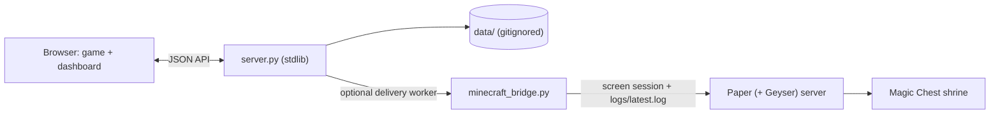
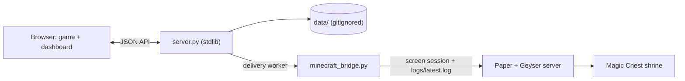

# Reading Village

A phonics-friendly (Orton-Gillingham style) reading game kit for an early reader. It is Minecraft-themed, runs on your
own computer, and is personalised for your child through one small file, `config/family.json`. A grown-up sits beside the
child for about ten minutes a day: The child reads short decodable stories and plays word games, and the grown-up taps
"Got it" or "Let's try again". Reading earns emeralds, Village Bells and surprise treasure, which the child spends in a
little village.

Two things are optional and off by default:

- **Real Minecraft rewards**, for families who run their own Java/Paper server: items the child earns are delivered into a
  Magic Chest in a shrine in your world.
- **An away-from-home website copy**, so the child can play at another house and send progress back in one emailed file.

Nothing is hosted for you. The game is a standard-library Python server plus a plain-JavaScript browser app. There is
nothing to install except Python 3 and a browser.

Not an official Minecraft product. Not approved by or associated with Mojang or Microsoft.

## Quick start

```
python3 server.py                          # serves and opens http://localhost:8642
python3 server.py --port 9000 --no-browser
```

- Game: http://localhost:8642
- Grown-up dashboard: http://localhost:8642/dashboard.html

Other flags: `--data-dir`, `--minecraft-config`, `--minecraft-worker auto|on|off`, `--minecraft-poll`.

## Make it yours

Edit `config/family.json` (child name, village name, grown-up label, away-from-home label). The server and the browser
both check it at startup and refuse to run on a mistake, naming the field. [SETUP.md](SETUP.md) is an interview you
paste into Claude Code: it asks about your child and family, then writes starter stories and settings for you.



## Features

- **Two reading tracks**: Track 1 shows **small caps** standing in for lowercase (capital shapes at lowercase size);
  Track 2 is true **lowercase**, in parallel, with explicit work on mirror-prone letters (b/d, p/q, n/u, m/w). Every
  story is read first in small caps, then lowercase.
- **Stories**: short decodable stories with pictures (`stories/*.json`).
- **Mini games**: Crafting Table, Word Blocks, Letter Mine, Bridge Match.
- **Phonics-ladder levels** for the mini games, with level-up surprises.
- **Village**: 13 villagers the child unlocks and trades with, plus a Wandering Trader.
- **Treasure Pile + Send**: bought and found items wait in the pile until the child chooses what to Send.
- **Magic Chest shrine + Magic Necklace**: items are delivered into a chest in a shrine built in the real world,
  even while the child is offline; a necklace (data pack) teleports them there.
- **Real-texture mode** (optional, local only): real Minecraft art instead of the hand-drawn pixel art.
- **Grown-up dashboard + rewards history**: progress, problems, and an append-only log of every reward change.



## Quick start

Requirements: Python 3 (the server uses only the standard library) and a browser. Node is needed only for the JS
tests. Minecraft is optional for playing; it is needed for deliveries (sends wait until the server is up).

```
python3 server.py                          # serves and opens http://localhost:8642
python3 server.py --port 9000 --no-browser
```

- Game: http://localhost:8642
- Dad dashboard: http://localhost:8642/dashboard.html

Other flags: `--data-dir`, `--minecraft-config`, `--minecraft-worker auto|on|off`, `--minecraft-poll`.

## Minecraft rewards (optional)

Off by default (`config/minecraft.json` has `"enabled": false`; its coordinates and names are example values). You need a
Java Paper server you run yourself, started through a `mc.sh` helper in a detached `screen` session (the game types
commands into that session). Geyser/Floodgate is optional, if a Bedrock device should join.

- Set `spawn-protection=0` in `server.properties` and restart, otherwise non-ops cannot open the chest.
- The player's gamertag goes in gitignored `config/private_overrides.json`, never in committed config.
- Back up the world, then build the shrine once with `tools/minecraft_install.py` (`--survey-only` checks the site; it
  refuses to build if spawn protection would block the chest).

Full guide, daily routine and troubleshooting: [docs/minecraft-rewards.md](docs/minecraft-rewards.md).

## Playing away from home (optional)

A static website copy lets the child play at another house. It starts from a snapshot of their status and keeps its play
in that browser; a big "Send to <grown-up>" button downloads one file that the helper emails back. The grown-up imports it
from the Dashboard and the home computer republishes the website. The home computer stays the one real record, and
nothing on it accepts outside connections. It is off until you set up `config/web.json` (`python3 tools/publish_web.py
--setup`). Details: [docs/away-from-home.md](docs/away-from-home.md) (contract), [docs/away-guide.md](docs/away-guide.md)
(guide for the helper), [docs/minecraft-rewards.md](docs/minecraft-rewards.md) (home guide).

## Real textures (optional, never included)

This repository contains no Minecraft textures. Each family can extract them from its own copy of the game:

```
python3 tools/extract_mc_textures.py                 # reads your own client jar; needs Pillow
python3 tools/extract_mc_textures.py --jar /path/to/client.jar --scale 8
```

Output goes to `app/assets/mc/`, which is gitignored and **never committed or shared** (the textures belong to Mojang;
the extractor refuses to write to a path git does not ignore). See [docs/textures.md](docs/textures.md).

## Privacy

All of the child's data stays on your computer in `data/`, which is gitignored (as are `config/private_overrides.json`
and `app/assets/mc/`). Nothing is sent anywhere unless you turn on publishing; publishing is opt-in, and every byte of
the website is scanned for private values before anything is pushed (the publish fails instead). If you keep your copy
in a public repository, check `git status` and the diff before every push.

## Tests

```
python3 -m unittest discover tests     # Python tests
node --test tests/js/                  # JavaScript unit tests
```

- `test_ui_levels.py`, `test_ui_village.py`, `test_ui_smallcaps.py` are browser tests and **require Playwright**
  (without it they error rather than skip, so a missing check cannot look like a pass).
- `test_extract_mc_textures.py` needs Pillow but no jar (it uses synthetic textures).
- One render test in `test_shrine.py` is skipped unless the local Minecraft jar exists.
- Minecraft is faked in tests (`tests/fake_minecraft.py`); no live server is needed.

## Repository layout

| Path | What it is |
|---|---|
| `server.py` | Local stdlib server: JSON API, static files, delivery worker thread |
| `minecraft_bridge.py` | Config validation, village rules, delivery ledger, rewards history, console transport |
| `app/` | Game (`index.html`) and dashboard (`dashboard.html`); logic in `app/js/`, editable word lists in `app/data/` |
| `config/` | `family.json` (personalisation), `minecraft.json`, `web.json`, `private_overrides.json` (gitignored) |
| `stories/` | Story JSON (source of truth) and index |
| `tools/` | Shrine installer, texture extractor, page render tools, Magic Necklace data pack, `publish_web.py` |
| `tests/` | Python and JS tests, fake Minecraft, fixtures |
| `docs/` | Design and architecture docs |
| `data/` | The child's private progress and ledgers (gitignored, created on first run) |

Add a story: write `stories/<id>.json` (schema in `docs/design.md`) and add its id to `stories/index.json`.

## Documentation map

- [SETUP.md](SETUP.md): make it yours, with Claude Code.
- [docs/overview.md](docs/overview.md): start here; goals, systems, layout.
- [docs/architecture.md](docs/architecture.md): components, data ownership, key flows, invariants, where to change things.
- [docs/family.md](docs/family.md): `config/family.json`, the personalisation file.
- [docs/design.md](docs/design.md): the contract ( tracks, events, progress, API, stories, village, install tool).
- [docs/minecraft-rewards.md](docs/minecraft-rewards.md): the optional Minecraft side.
- [docs/away-from-home.md](docs/away-from-home.md): contract for the website copy, export and import.
- [docs/away-guide.md](docs/away-guide.md): plain-language guide for the helper at the other house.
- [docs/textures.md](docs/textures.md): real-texture mode and its licensing rules.
- [SOLUTIONS.md](SOLUTIONS.md): bug-fix log with root cause and solution.

## Ground rules

- **Loud failure**: failures stop visibly (banner, FAILED message, non-zero exit); no silent fallbacks.
- **Explicit data contracts**: validate at boundaries; change a contract only with its consumers and docs.
- **Child data stays private**: progress, events, ledgers and the gamertag live only in gitignored `data/` and
  `config/private_overrides.json`.
- **Textures are never committed**: confirm `git status` shows nothing under `app/assets/mc/` before any push.
- **Test Minecraft changes on a copy of the world first**, and back up before installing anything live.
- Record every bug fix in SOLUTIONS.md and keep `docs/` in step with behavior.

## Licence

The code is MIT ([LICENSE](LICENSE)). The OpenDyslexic font in `app/fonts/` is under the SIL Open Font License
(`app/fonts/LICENSE-README.txt`). Minecraft is a trademark of Mojang/Microsoft; see the note at the top.
