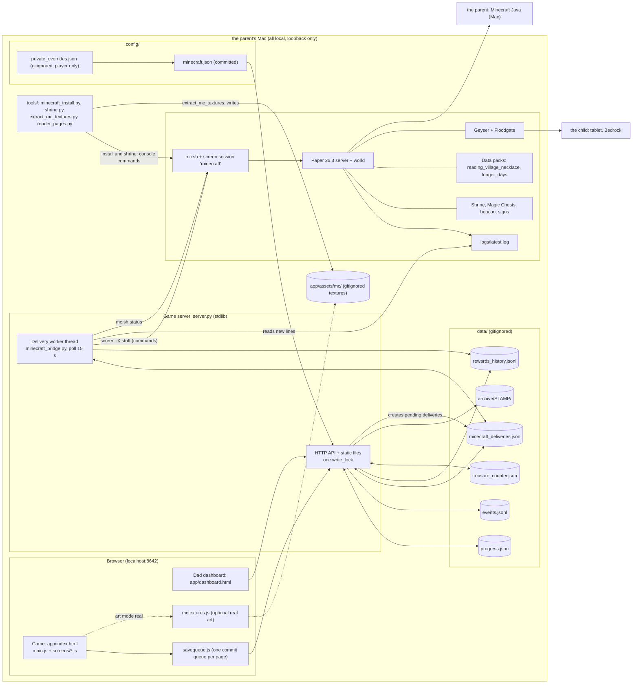
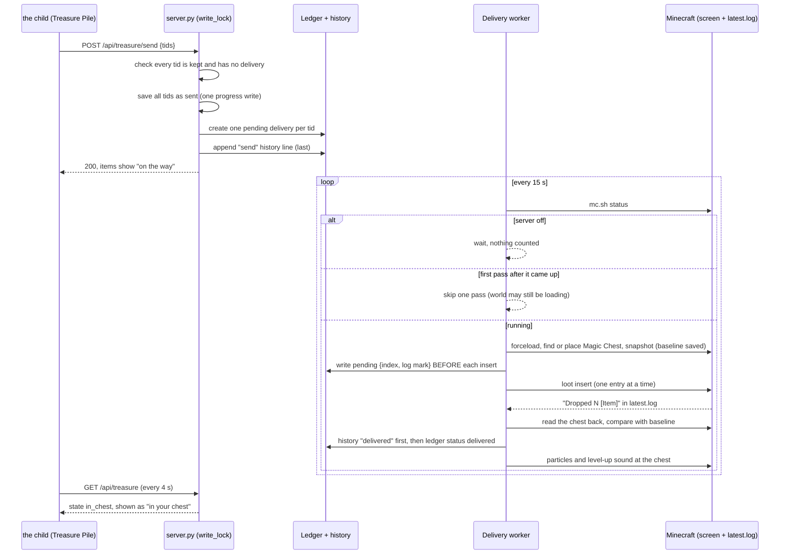

# Architecture

Last checked against the code: 2026-10-21. Contracts live in `docs/design.md`; the child/Dad guide is
`docs/minecraft-rewards.md`; the art mode is `docs/textures.md`. This file is the map: what the parts are, who owns
which state, how a request travels, and which rules must never be broken.

## 1. Purpose

The child reads words and stories in a browser game on the parent's Mac, with Dad beside them.
Every correct answer is saved, shown to Dad on a dashboard, and paid out as Minecraft rewards: emeralds, Village Bells
and surprise treasure. The child spends emeralds with villagers, collects items in a **Treasure Pile**, and chooses to
**Send** them; a background worker then types console commands into the real Paper Minecraft server and puts the items
into a **Magic Chest** inside a pagoda shrine in their world, which the child can reach from a Java or Bedrock device (Bedrock via Geyser). The
system is local only (loopback), has no accounts, and is built so that a failure is loud (a banner, a FAILED line, a
non-zero exit) and nothing is ever granted, sent or delivered twice.

## 2. Components

The delivery worker runs inside the game server process. If the game server is stopped, sends queue in the ledger
and wait. If Minecraft is stopped, the worker waits and the dashboard says so.

### 2.1 Browser game (`app/index.html`, `app/js/`)
- **Does:** every screen the child sees (Home, Word Blocks, Story, Letter Mine, Bridge Match, Crafting Table, Build,
  the village, Treasure Pile, Treasure Book) plus Dad's bar and Settings (including the per-game Levels override).
  Letter Mine and Bridge Match are lowercase-track drills: locked on Home (`LOWERCASE_STAGES`) until Dad turns the
  lowercase track on, because the mirror-letter confusions they train exist only in lowercase shapes.
- **Owns:** nothing durable. It holds a copy of `progress` in `store` (`store.js`) and the current session id.
  It owns the client-side earning of wood, stone, ore and emeralds (it mutates `progress.inventory` and saves it).
- **Key files:** `main.js` (boot, Home, stage launching, adventure sequence, Dad clock), `store.js` + `savequeue.js` +
  `api.js` (persistence), `rules.js` (letter rules, ores), `villagelogic.js` (validation of every server reply, level
  badges, sprite stand-ins), `surprise.js` (toast and mini-game level-up celebration), `mcstatus.js` (Dad status line),
  `levels.js` (derived mini-game levels, trackers, round pickers, Letter Mine / Bridge Match decks),
  `screens/*.js`, `sprites.js` and `scenes.js` (art), `sounds.js` (Web Audio, no files).

### 2.2 Dad dashboard (`app/dashboard.html`, `app/js/dashboard.js`)
- **Does:** reads events, progress, `/api/village`, `/api/treasure`, `/api/minecraft`, `/api/history` and `levels.json`; shows letter and
  fluency stats, the Levels panel (derived in the browser by `levels.js` from the events), the Minecraft panel (red banner on any problem), the rewards history and a CSV link; lets Dad change
  active letters, the lowercase track, the swap-in slider and sound.
- **Owns:** nothing. Its saves use the same `savequeue.js`, so it can stay open beside the game.
  Each fetch whose failure matters is wrapped so it becomes a red banner, not a dead page.

### 2.3 Game server (`server.py`)
- **Does:** serves `app/` and `stories/` (`Cache-Control: no-store`), validates and stores progress and events,
  enforces optimistic concurrency, prices every shop action, rolls surprises, derives points/level/bells and the mini-game levels (`derive_levels`), writes the
  rewards history, creates deliveries, resets and archives. Python stdlib only. Binds `127.0.0.1` and `::1` on one port
  (both must bind or startup fails) with one shared `write_lock`.
- **Owns:** `progress.json` (together with the client, see section 4), `events.jsonl`, `treasure_counter.json`,
  `archive/`, and it is the only creator of ledger entries and of every history line except the two the worker writes.
- **Key files:** `server.py` (validation tables `EVENT_FIELDS`, `validate_progress`, routes, `event_rewards`,
  `treasure_send`, `village_unlock`, `shop_buy`, `reset_progress`, `load_levels`, `derive_levels`), `config/minecraft.json`,
  `app/data/levels.json`.
- **Start-up checks:** `app/data/levels.json` and `craft_words.json` must load and validate (a wrong version or field
  stops the server; `words.json` is read and validated by the browser); a corrupt `progress.json` is refused (never overwritten); an invalid Minecraft config exits with
  `FAILED: invalid Minecraft config`; a `sent` treasure with no delivery (crash between two writes) gets its delivery
  and a `RECOVERED` line (`reconcile_sent_treasure`).

### 2.4 Delivery worker (`minecraft_bridge.py`: `DeliveryWorker`, `Bridge`, `ScreenTransport`)
- **Does:** every 15 s (`POLL_SECONDS`), if Minecraft is up, takes pending ledger entries oldest first and puts each
  into a Magic Chest, confirming every insert in `logs/latest.log` and reading the chest back.
- **Owns:** the status fields of ledger entries (`status`, `attempts`, `last_error`, `chest`, `baseline`, `inserted`,
  `confirmed`, `pending`) and the `delivered` / `delivery_failed` history lines. `GET /api/minecraft` returns the
  worker's state as top-level fields (`enabled`, `worker_running`, `server_running`, `problem`, plus the pending/failed/recent
  lists); `GET /api/treasure` carries `enabled`, `server_running`, `problem` and `rev`.
- **Transport:** `screen -S <session> -p 0 -X stuff "<cmd>\r"` to send, new bytes of `<mc_dir>/logs/latest.log`
  ("System chat: ...") to read replies, `<mc_dir>/mc.sh status` (exit 0 running, 3 stopped) for liveness. No RCON, no
  network port.
- **Start flag:** `--minecraft-worker auto|on|off`. `auto` starts it only for the real `data/` directory, so a test or
  tool that passes a temp `--data-dir` can never deliver into the real world.

### 2.5 Config (`config/minecraft.json`, `config/private_overrides.json`)
`minecraft.json` is committed and checked strictly at startup (unknown key, bad id, bad sprite, bad level: the game
will not start). It holds the earn rates, sell trades, 13 villagers plus the Wandering Trader with 188 offers,
surprise tiers, craft items, level thresholds, chest spots, `forbidden` cells, the `shrine` origin, `mc_dir` and
`screen_session`. `private_overrides.json` (gitignored) may override only `player` (the child's gamertag, kept out of
the public repo; the worker delivers by coordinates and does not use it today).

### 2.6 Data files (`data/`, gitignored: this is a child's private record)
See the table in section 3. `data/` is never committed, and a reset never deletes anything from it.

### 2.7 Minecraft server (`<MC_DIR>`, outside this repo)
Paper 26.3 with Geyser and Floodgate (so a Bedrock tablet, Bedrock, joins the same world as the parent's Java client).
Run only through `mc.sh start|stop|status|cmd|backup` (a detached `screen` session named `minecraft`); a server
started with `start.sh` has no screen session, so the worker cannot reach it (`server_running()` raises
"running outside a screen session"). Logs at `logs/latest.log`. In the world: the **shrine** (pagoda, beacon, Magic
Chest 1 at 100 68 100, entrance sign, a `village_name` sign beside spawn), overflow **Magic Chests 2..9** placed
inside the hall by the worker, and two data packs.

### 2.8 Data packs
- `reading_village_necklace` (source `tools/datapacks/reading_village_necklace/`, installed in `world/datapacks/`): the Magic Necklace,
  which teleports the holder to the shrine. See flow 4.10.
- `longer_days` (lives only in `<MC_DIR>/datapacks/`, documented in that repo's README): daytime lasts twice
  as long. Unrelated to the reading game; listed because it shares the world.

### 2.9 Tools (`tools/`)
- `minecraft_install.py` + `shrine.py` + `shrine_blocks.json` (design as data) + `shrine_render.py`: survey, build and
  draw the shrine. The installer refuses to build when `server.properties` `spawn-protection` would stop a non-op player
  (the child) from opening the chest (flow 4.9).
- `extract_mc_textures.py`: copies and composes real textures from the parent's own jar into `app/assets/mc/`, including 21 real
  mob pictures (`mobs/<mob>.png`) for the craft words.
- `render_pages.py` + `caption_pages.py`: dev-only story picture review (Playwright, local Ollama). They start the
  server on a temp data dir with the worker off.

## 3. Data ownership

| State | Lives in | Written by | Stored or derived | Validation |
|---|---|---|---|---|
| Letters, stats, inventory (wood, stone, ore, emerald), house, stories, settings, `crafted` | `data/progress.json` | Client (via `PUT /api/progress`); server writes rev | Stored | `validate_progress` on every PUT and every read; unknown field is a 400/500 |
| `progress.village` (`unlocked`, `bells_spent`, `emeralds_spent`, `levels`) | `progress.json` | Server only (unlock, buy, promote, reset) | Stored | PUT must carry it unchanged (400 otherwise); `levels` only for unlocked villagers; sum(levels) must not exceed the promotions earned (else `GET /api/village` is a loud 500) |
| `progress.treasure` (the pile) | `progress.json` | Server only (events, buy, unlock, send) | Stored; entries never removed | Same; `tid` format, items, source kind, status `kept`/`sent` |
| `rev` | `progress.json` | Server (+1 on every save) | Stored | Compare-and-write under the lock; mismatch is 409 |
| Events (reading, cards, stories, craft, sessions) | `data/events.jsonl` | Server (append on `POST /api/event`, fsync) | Stored, append-only | `validate_event` on write and on every read; bad line is a 500 naming it |
| Minigame levels (craft, blocks, mine, match) | not stored | Client (`levels.js`) and server (`derive_levels`), per request | **Derived** from events (event `level` field) + `app/data/levels.json`; Dad's `settings.level_override` wins for display and drilling, never for the derived level | Same rule in both languages; `levels.json` validated strictly on load; `level` field validated on every event |
| Dad's level override | `progress.settings.level_override` `{game: level}` (optional) | Client (Settings > Levels, via `PUT /api/progress`) | Stored | 400 on an unknown game or a level outside 1..max (`check_level_override`); "Automatic" deletes the key |
| Level-up surprises (`source.ref` `minigame_level:<game>:<n>`) | `progress.treasure` | Server only (`event_rewards`) | Stored in the pile, once per game and level | Ref already in the pile is skipped; a retried event finds it by event key |
| Level thresholds (`max`, `window`, `need` per game) | `app/data/levels.json` | Parent (by hand) | Config | Strict; server reads at start, browser on page load |
| Reading points, reading level (informational), bells earned/available | not stored | Server, per request | **Derived** from events + `active_letters` (+ `bells_spent`) | Recomputed each time (`village_state`) |
| Wood/stone/emerald balance after a change | `progress.inventory` | Client earns; server spends (buy, unlock, sell) | Stored | Server prices from config; client sends only ids |
| Deliveries | `data/minecraft_deliveries.json` | Server creates (`pending`); worker updates | Stored, never deleted | `validate_ledger` on every read; a bad file raises and is never overwritten |
| Rewards history | `data/rewards_history.jsonl` | Server (earn, spend, trade, treasure, unlock, promote, send; `level` lines are historical); worker (delivered, delivery_failed) | Stored, append-only, survives reset | `validate_history_line` on write and read; a bad line is a 500 |
| Treasure id counter | `data/treasure_counter.json` | Server | Stored, monotonic | `{"v":1,"last":N}`; corrupt is a loud 500, never overwritten |
| Reset archives | `data/archive/<stamp>/` | Server (`POST /api/reset`) | Moved copies of `progress.json` and `events.jsonl` | Written before the fresh file; rolled back on failure |
| Shop prices, levels, earn rates, chest spots, shrine origin | `config/minecraft.json` | Parent (by hand) | Config | Strict at startup |
| Gamertag | `config/private_overrides.json` | Parent (by hand) | Config, gitignored | Only the `player` key is accepted |
| Word list (v2, phonics level per word), cues, swap order, craft words (v2, level and pattern per word) | `app/data/*.json` | Parent (by hand) | Config | Validated on load in `data.js` / `craft.js` / `server.load_craft_words`; level must match pattern; `tests/test_word_levels.py` checks the ladder rules |
| Stories | `stories/*.json` + `index.json` | Parent (by hand) | Config | `validateStory`; ASCII letters only; unknown art is a loud error |
| Art mode (hand or real) | Browser `localStorage` `reading_village_art_mode` | Dad's Settings | Per browser | Unknown value is a loud error |
| Real textures (items, blocks, villagers, 21 mob pictures) | `app/assets/mc/` + `manifest.json` | `extract_mc_textures.py` | Generated, never committed | Manifest checked against `mctextures_map.json` |
| The world (shrine, chests, signs, beacon) | `<MC_DIR>/world` | Install tool, delivery worker (overflow chests), data packs | Live game state | Survey before build; read-back after insert |

The one deliberately shared piece of state is `progress.inventory`: the client grants what the child earns, the server
removes what the child spends. Everything the server does to it is one atomic progress write.

## 4. Key flows

### 4.1 A reading turn (one word, correct)
1. Dad taps "Got it!" in Word Blocks. `blocks.js` `record` calls `commitUntilSaved(event, mutate)`.
2. `savequeue.js` serialises it behind any earlier save. It builds the event **once** (`makeEvent`: `v`, local ISO `ts`,
   `session_id`, fields) so a retry re-posts the identical event.
3. Progress first: the mutate function runs on a copy (+1 wood or stone, +`word_emerald` emerald) and
   `PUT /api/progress` is sent with the extra field `cause` = that event. A 409 means another window saved first: the
   client GETs fresh progress, re-applies the same mutate once, PUTs again; a second 409 locks with the
   PROGRESS NOT SAVED banner.
4. Server `do_PUT`: validate event (`cause`) and progress, check `rev` under `write_lock`, check `village` and
   `treasure` are unchanged, then `record_client_changes` writes an `earn` history line (net increase per resource,
   `last_event` = the cause) and a `spend` line per resource that went down, then writes `progress.json` with `rev+1`.
5. The event: `POST /api/event`. Server validates it, computes `event_key`, runs `event_rewards` (craft item, story
   surprise, streak10, adventure_done, minigame level-up), writes the `treasure` history lines, saves the progress
   with the new treasure (`rev+1`), and only then appends the event line (fsync).
6. The reply is `{ok:true, treasure?:[{label,sprite}], game_level_ups?:[{game,level}]}`. `surprise.js` validates it, shows the
   "A surprise for your Treasure Pile!" toast (never blocking) and queues mini-game level-ups; because the server bumped `rev`,
   the client reloads progress.
7. A failed step at any point shows the red banner and the queue waits; nothing more is awarded until Dad retries.

Order matters: treasure is saved before the event line, so a crash can only give an extra item, never lose one.

### 4.2 Bells, promotions and levels
Reading points and bells are not stored: `village_state` derives them from the events on file. Bells = first story
passes + points // 40; available = earned - `village.bells_spent`. The old shared village level (and its `level_up`
surprise, `level` history line and celebration) is gone: `event_rewards` returns only the new treasure entries.

**Villager promotions** (flow 4.2b). Levels are per villager and keyed to emeralds spent. `progress.village` holds two
server-owned keys: `emeralds_spent` (counter, bumped in the same atomic write as every emerald spend: `shop_buy`,
`village_unlock` with `pay: emeralds`) and `levels` (`{profession: 0..4}`). `promotion_state` computes
`earned = promotions_earned(cfg, emeralds_spent)` (`village.promotions`: thresholds, then every N), `used = sum(levels)`,
`available = earned - used`. `POST /api/village/promote {profession}` -> `village_promote` under `write_lock`: 409 if the
villager is not unlocked, already Master, or `available < 1`; otherwise it appends a `promote` history line and saves the
new level with `rev+1`. Two racing taps serialise on the lock; the second sees `available == 0` and gets a 409. `shop_buy`
compares `offer.min_level` with that villager's own level. A progress.json without `emeralds_spent` is seeded once from the
history's emerald `spend` lines since the newest `data/archive/<stamp>` (`village_spent`); "Reset progress" writes fresh
progress with `0` / `{}`. The client shows the choice (banner -> picker -> confirm -> celebration) and never writes these keys.

Mini-game levels are a separate, parallel mechanism: see flow 4.12.

### 4.3 Unlocking a villager
`POST /api/village/unlock {profession, pay}` -> `village_unlock` under the lock. The first unlock is free whatever `pay`
says. Later: `bell` needs one available bell (`bells_spent += 1`); `emeralds` costs `unlock_emeralds` (400 bad body,
409 refused). The Wandering Trader requires all 13 others and gives a trader egg plus 2 trader llama eggs. History
lines (`unlock`, `spend`, `treasure`) are written first, then wallet, village and the new treasure (a villager spawn
egg plus the job-site block) are saved in **one** progress write.

### 4.4 Buying and trading
- Buy: `POST /api/shop/buy {offer_id}`. Server checks the villager is unlocked, that villager's level >= offer `min_level`,
  and emeralds >= price; then writes a `spend` and a `treasure` history line and saves emeralds, the new treasure and
  `village.emeralds_spent` in one write. Enchanted books exist only at the librarian.
- Sell: `POST /api/shop/trade {trade_id}` applies a `give`/`get` pair from config (for example 10 wood for 1 emerald)
  and writes a `trade` line.
- Every POSTing button on the Village screen goes through `act()` (a synchronous `busy` flag) so a double tap is one
  request.

### 4.5 Treasure Pile, Send and delivery (the main loop)

Numbered detail:
1. `POST /api/treasure/send {tids}` (`treasure_send`): 400 for a bad body, repeated or unknown tid; 409 if any tid is
   already sent or delivery is disabled; nothing changes unless every tid is valid.
2. All tids are marked `sent` in one progress write; then one ledger entry per tid (`source.ref` = tid; the ledger
   refuses a second delivery for the same tid). If creating a delivery fails the marks are rolled back; if that also
   fails the error says so. The `send` history line is written last. The client shows the portal scene only after the
   server has accepted; a refused send is a red SEND FAILED overlay.
3. The worker (`run_once`): `server_check()` via `mc.sh status`. Off means wait. The first pass after it first sees the
   server up (or its state was unknown) is skipped, because `mc.sh status` says running while the world still loads.
4. `Bridge.deliver`: forceload the chunk; `pick_chest` walks `config.chests` in order. A Magic Chest (CustomName starts
   "Magic Chest") with enough free slots is used; a free spot (air or loose plants, no fluid, solid ground below, not
   `forbidden`) gets the next chest ("Magic Chest 2"...), decorated and labelled; if none, `AllFull` ("All Magic
   Chests are full": stays pending, no attempt counted).
5. The chest contents are read first (`baseline`, saved with the delivery). Before each `loot insert` the worker saves
   `pending = {index, mark:[log inode, offset]}`. Unstackable or multi-count entries are expanded so each is its own
   insert. Each insert must answer exactly `Dropped N [...]` / `Dropped N items` with N = the wanted count.
6. After all inserts the chest is read back and every item's total, enchantment, potion and profile must have grown by
   exactly what was sent (`verify`). Only then: history `delivered` line (with the confirming log lines), ledger status
   `delivered`, then the cosmetic particles and level-up sound.
7. `GET /api/treasure` maps ledger status to `state`: `kept`, `on_the_way` (pending), `in_chest` (delivered),
   `failed`. The pile polls every 4 s.

### 4.6 Failure and retry paths
- **Minecraft off:** the delivery stays `pending`; `server_running` is false; dashboard and Dad bar say "Server: NOT
  running (sends wait until it is up)". Not an error, no attempt counted.
- **Chest full:** next chest spot is used; if all nine are full or unusable: `problem` = "All Magic Chests are full",
  delivery stays pending, red banner.
- **Transient failure (`McError`):** attempt counted; one retry on the next poll; a second failure marks the delivery
  `failed` with the raw evidence in `last_error`, writes a `delivery_failed` line, and shows
  "n DELIVERY FAILED: <reason>". A failed entry never blocks the next one.
- **Read-back mismatch (`VerifyError`):** fails at once, never retried (items may already be in the chest).
- **Late or missing reply (ambiguous reconcile):** if a `Dropped` reply arrives after the 8 s timeout, the retry does
  not re-insert blindly. It compares the chest's change since `baseline` (minus its own confirmed inserts) with whether
  a `Dropped <count>` line follows `pending.mark`. Only two cases are clear: no change and no reply (insert it) or
  exactly the pending entry and a reply (it landed, counted, evidence "reconciled by read-back and log"). Anything else
  (items taken out, an extra matching item, reply without items, items without reply, a rotated log) raises
  `VerifyError` with the evidence, inserts nothing and fails the delivery loudly. An old entry with inserted items but
  no baseline also fails loudly.
- **Worker crash mid-delivery:** the loop catches every exception, stores it in `problem`, prints it to stderr and
  continues; the entry stays as it was and the next pass reconciles.
- **Server crash between "sent" mark and delivery:** startup `reconcile_sent_treasure` creates the missing delivery.
- **History write fails:** the request fails (500) and changes nothing; the worker writes the history line before it
  changes the ledger, so a failed ledger write leaves the entry pending and the retry does not duplicate the line.

### 4.7 Reset and archive
Dad types `RESET` in Settings. The client ends the open session, then `POST /api/reset {"confirm":"RESET"}`. Under the
lock the server moves `progress.json` and `events.jsonl` into `data/archive/<YYYYMMDD-HHMMSS>/` (`-2` on a name
clash), writes fresh default progress with `rev` = old rev + 1 (so a stale tab gets a 409), and rolls the move back if
any step fails. Nothing is deleted. What survives: `rewards_history.jsonl`, `minecraft_deliveries.json`, the treasure
counter (ids never restart) and everything already in the world. What resets: letters, inventory, house, stories, the
village (so the first villager is free again, every level and the emeralds-spent counter are back to 0), the pile
(archived with the progress) and, because events are archived, reading points and bells.

### 4.8 Earning rules in one place
Client grants (via progress save): +1 wood/stone and +`word_emerald` per correct or assisted word; +`story_first_emerald`
(5) on a first story pass and +`story_replay_emerald` (2) on a replay; +`craft_emerald` per craft. Server grants
treasure (not resources) from accepted events: craft item, `story_first` surprise, a replay surprise for every later
finished read of a story (`story_done` again, or `swap_done` from a letter swap-in read; replay N gets tier
`surprises.story_replay_tiers[min(N-1, len-1)]`, shipped epic then legendary; N is derived from `events.jsonl` by
`replay_count`, never stored; `source.ref` = `story_replay:<track>:<story>:replay<N>:<tier>`), `streak10` (every
10th independent correct card/match/word in a row in one session), `adventure_done` (once per session and adventure),
`minigame_level` (rare, once per game and level). Villager promotions are chosen by the child (flow 4.2), not granted. Spending (buy, unlock, build, sell) is the only place anything is taken away.

### 4.9 The shrine install (once, by Dad)
`python3 tools/minecraft_install.py --mc-dir <MC_DIR> --session minecraft [--survey-only]`:
1. Load config; `chests` must equal the shrine's chest spots (from `shrine_blocks.json` and `shrine`), and `forbidden`
   must contain the world spawn read from `world/level.dat`.
2. `server.properties` in the Minecraft directory must have `spawn-protection=0` (`check_spawn_protection`). Spawn protection stops
   non-op players (the child) from using blocks near world spawn, so the child could not open the chest. The tool reads the file (a
   missing file, key or non-integer value is a FAILED), and for any radius of 1 or more prints FAILED, names the radius and the
   affected cells (the spawn sign always counts, as it stands within 2 cells of spawn) and builds nothing. Fix the file and
   restart with `mc.sh stop` / `mc.sh start`.
3. The server must be running in the screen session. Forceload the chunks.
4. Look for the marker armor stand (tag `reading_village_shrine`): found means a re-run that only fills what is missing.
5. **Survey every target cell** (columns compared against a sky reference to save commands): each must be air or a
   loose plant; foundations must be air or a plant down to solid ground. One blocked cell refuses the whole build, lists
   the blocked cells, prints FAILED and places nothing (exit 1).
6. Find a spawn-sign spot by survey (never the spawn cell).
7. Build with `setblock ... keep` (air) or the guarded `execute if block <cell> <plant> run setblock ... replace`
   (a surveyed plant), never `fill`; then chest 1, its floating label, the spawn sign, and verify the beacon
   (`Levels` >= 1). Re-runs are idempotent.
8. `--survey-only` stops after step 6. Back up the world first (`mc.sh backup`); the tool does not.

### 4.10 The Magic Necklace
A Heart of the Sea with custom name, lore, glint and `custom_data {reading_village_necklace:true}`, obtained from the loot table
`reading_village_necklace:necklace` (spare: `/loot give @s loot reading_village_necklace:necklace`). Every tick `tick.mcfunction` counts
the cooldown (`cn_cd`) down and runs `player` for each player. `player` restores the full item if a right-click left a
copy without `use_remainder`; if the player holds the necklace and sneaks it adds one to `cn_sneak` each tick (reset by
any break), and at 20 ticks (about 1 s) runs `go`: effects, `tp @s 100 68 104 180 0`, cooldown 100 ticks (5 s). The
Java right-click path is an advancement on `consume_item` that runs `use`. Overworld only; never used up.

### 4.11 Real-texture mode
Local only. `extract_mc_textures.py` reads the parent's own client jar and writes `app/assets/mc/**` plus `manifest.json` (after
checking that the target is git-ignored; all outputs are built in memory first and any problem is a FAILED banner).
It also composes 21 mob pictures (`mobs/<mob>.png`, one per mob craft word: pig, bat, pup/wolf, hen, chick, fox, frog, squid,
fish/cod, mule, slime, blaze, goat, sheep, bee, cow, rabbit, panda, camel, piglin, hoglin) from the mobs' entity textures with
the same rasteriser as the villagers, using model boxes read from the client; a texture of an unexpected size, an unknown mob
or a missing texture is a FAILED line and nothing is written. In real mode a mob craft word shows its picture instead of a spawn
egg. `chick` and `blaze` are their own sprite ids (stand-ins `hen` and `torch`), so hand mode is unchanged.
In Settings, Art "real" is offered only when `manifest.json` is served; switching loads every texture first and saves
the mode in `localStorage` only if that worked. At boot `main.js` awaits `configureTextures(mode)`; "real" with a
missing manifest or texture is a "Could not start" screen naming the sprite, never a silent hand-drawn game
(`/?art=hand` resets). `sprites.js` draws a mapped id from its texture and an id listed in `unmapped` from the hand-drawn
grid on purpose; an id in neither list throws. Textures never leave the machine.

### 4.12 Mini-game levels
Each of the four mini games (Crafting Table `craft`, Word Blocks `blocks`, Letter Mine `mine`, Bridge Match `match`) has a
level. It is **derived, never stored**, so a reset (which archives the events) starts again at level 1.
1. **Thresholds.** `app/data/levels.json` gives each game `max`, `window` (10) and `need` (8). The browser loads it
   (`loadLevels`, strict `validateLevels`) and the server loads it at start (`load_levels`); any problem fails the page or the start.
2. **Start of a round.** The screen builds a tracker (`trackerFor` in `levels.js`) from `GET /api/events` and Dad's
   `progress.settings.level_override`, and fixes the round level once (`roundLevel`): the override if set, else the derived level.
   Craft and Word Blocks pick words by level (`pickAtLevel`: above level 1, 80% at the level and 20% review from level L-1, 4+1 of 5 for craft;
   no confusable-letter gate, since both are small caps and that gate is lowercase-only); Letter Mine and Bridge Match choose the deck and the number of choices from the level.
3. **Each attempt.** The event carries `level`: the round's level for Letter Mine and Bridge Match, but the **word's own** level
   for Craft and Word Blocks, so a review word mixed into a level-2 round carries `level: 1` and never counts toward level 2. The
   tracker absorbs it locally and the screen's level line updates ("Level 2: blends", "7 of 8 right at level 2").
4. **The rule** (`step` / `deriveLevels` in `levels.js`, mirrored by `derive_levels` in `server.py`): an event counts only when
   its `level` equals the current derived level (none = 1); after at least `window` counted attempts, with at least `need` of
   the last `window` `correct` (assisted and miss are never independent), the level goes up and the count restarts. Never
   demotes, never beyond `max`.
5. **Server side.** `POST /api/event` validates `level` (1..99, and at most the game's `max`); `event_rewards` calls
   `derive_levels` over the events on file plus the new one, and for every level reached that has no treasure with
   `source.ref == "minigame_level:<game>:<n>"` yet it rolls one **rare** surprise (once ever per game and level), writes the
   usual `treasure` history line and returns `game_level_ups:[{game,level}]`.
6. **Client side.** `surprise.js` queues the level-ups and shows "Crafting level 3!" at the same
   calm moments (between stages, after the adventure, on Home).
7. **Dad.** The dashboard Levels panel shows the level in force, its name and the count toward the next level. Settings >
   Levels sets `level_override` per game ("Automatic" removes it). The override changes what a screen drills and shows; the
   derived level keeps counting on its own and still decides the surprises.
8. **Letter Mine and Bridge Match** are lowercase-track drills: locked on Home until the lowercase track is on, and they drill
   only letters whose mirror partner is also swapped in (else the calm "Not yet" screen, no events). Their levels therefore
   advance only after Dad opens that track.
The phonics ladder behind Craft and Word Blocks levels (six rungs, word-list rules) is in `docs/design.md` "Phonics ladder".

### 4.13 Away from home: static run mode, snapshot, export, import, publishing
The exact shapes are in [away-from-home.md](away-from-home.md) (the contract); this is the map.
- **Static run mode.** `app/js/runmode.js` exports `STATIC` (`false` in the repo; the publish tool writes `true` into the built copy). With `STATIC`, `api.js` sends every call to `app/js/offline.js` instead of `fetch`, with the same reply shapes and `ApiError` on failure. All app URLs are relative so the same files work from `python3 server.py` and from GitHub Pages.
- **Offline backend.** `offline.js` loads `snapshot.json`, keeps the child's play in `localStorage["cv_offline_v1"]` and refuses to run (loud fatal error) if it cannot load the snapshot or keep storage. Shop, send and reset calls answer 409 "That happens at Dad's house" and the UI shows them disabled. A second tab or a failed write shows the PROGRESS NOT SAVED banner.
- **Export.** `app/js/senddad.js` draws the Home button "📨 Send to Dad" and the full-screen prompt after Finish; it downloads `reading-village-YYYY-MM-DD-HHMM.json` (cumulative since the base snapshot).
- **Import.** `POST /api/import` -> `import_export` in `server.py`, under `write_lock`: validate everything, skip duplicate events by hash, replay new events through `accept_event` (the body of `POST /api/event`, factored out so live play and import share one path), merge progress, write a receipt to `data/imports.jsonl`. All or nothing. Reply fields are in the contract.
- **Publishing.** `tools/publish_web.py` (`build_and_publish`) builds `build/web/`, writes `snapshot.json`, runs the scrub guard, and force-pushes one orphan commit to the public repo named in `config/web.json`. The server runs it in a background thread after `session_end` and after an import; status is `srv.web_status`, served at `GET /api/web`; `POST /api/web/publish` starts one now.
- **Invariant.** Nothing on Dad's Mac accepts outside connections; publishing is an outbound `git push`, and a failed publish pushes nothing.

## 5. Invariants and safety rules

**Loud failure.** A failure stops visibly and never looks like a result.
- Browser: any save failure is the PROGRESS NOT SAVED banner and no more awards; every server reply is validated
  (`villagelogic.js`, `mcstatus.js`, `historylogic.js`) and a bad shape throws naming the field; a village action failure
  is an overlay; no silent `localStorage` fallback for progress.
- Server: validation is strict (400 naming the field; unknown fields rejected; nothing coerced or defaulted except
  documented optional fields); a corrupt `progress.json`, ledger, history line, counter or events line is a 500 or a
  refusal to start and is never overwritten. 4xx/5xx are logged to stderr.
- Worker: failures are stored on the ledger entry with raw evidence, shown on the dashboard, and counted. Ambiguity is
  a failure, not a guess.
- Tools: FAILED banner, non-zero exit, before anything is written.

**No double grant, send or delivery.**
- Client builds each event once; the server's `event_key` = `<events on file>:<sha256[:16]>` lets a retry after a failed
  append find its treasure instead of creating it again. Not covered: a retry after the append succeeded but the
  response was lost (a new event; the client has no event id).
- Treasure ids come from `treasure_counter.json`, written before the id is handed out, kept above the pile and the
  ledger, never restarted by a reset.
- A tid can have at most one delivery (`Ledger.create` and `find_by_ref` refuse a second); a send of a non-`kept` tid is a
  409.
- The delivery's baseline, `confirmed` counts and `pending` mark make every retry a reconcile, not a re-insert.
- History lines are written before the change they describe (earn, spend, trade, treasure, unlock, level) and fail the
  request if they cannot be written; `send` is written last so a rolled-back send leaves none; the worker writes
  `delivered` / `delivery_failed` before the ledger changes and does not write the same line twice.

**Server-owned keys.** `progress.village` and `progress.treasure` change only through the unlock, buy, event and send
paths; a PUT carrying a different value is a 400. The client never sets them, and reloads progress after every
server-side change. The server prices everything from config; the client sends only ids.

**World safety (the family's real world).**
- The shrine and chests are built only on air or loose plants; anything else refuses the whole build.
- The world spawn cell (and the cell above it) is in `forbidden`: never built on, decorated or given a chest.
- Every placement is a single guarded `setblock` (`keep`, or `execute if block ... run setblock ... replace` for a
  surveyed plant); there is no `fill`.
- The game only adds items to a Magic Chest; nothing is taken from the child's Minecraft inventory.
- `spawn-protection` must be 0 on the server, or non-op the child cannot open the chest; the install tool refuses otherwise.
- Overflow chests need solid ground below and a free spot; occupied spots are left alone and logged.
- Chunks around the shrine are forceloaded so delivery works while the child is offline.

**Privacy and licensing.**
- `data/` (progress, events, ledger, history, archive, counter) is gitignored: The child's record.
- The gamertag lives only in the gitignored `config/private_overrides.json`; the committed value is `PlayerName`.
- `app/assets/mc/` is gitignored and the extractor refuses to write into a non-ignored location. Never commit, push or
  share textures, and never publish the shrine render. Code and the mapping JSON contain no Mojang assets.
- The repo is public: check the diff, commit message and author email before pushing.

## 6. Where to change things

| Want to change | Edit | Then |
|---|---|---|
| Emerald earn rates, sell rates, prices, villager unlock cost, offer `min_level`, items in an offer | `config/minecraft.json` (`earn`, `trades`, `village.professions[].unlock_emeralds`, `offers`) | Restart the game; past deliveries and history are unchanged |
| Level thresholds, bell rate, point weights | `config/minecraft.json` `village.levels`, `village.bell_every_points`, `village.points` | Restart. Level names need a badge in `LEVEL_BADGE` (`villagelogic.js`) and a sprite |
| Surprise contents or which tier an event uses | `config/minecraft.json` `tiers`, `surprises` | Restart |
| Level thresholds for the four minigames (`max`, `window`, `need`) | `app/data/levels.json` | Reload the pages and restart the server (it reads the file at start); `max` may not exceed the levels the game defines (`levelNames` in `levels.js`) |
| Letter Mine / Bridge Match deck or choice rules | `mineDeck` / `matchDeck` in `screens/mine.js` / `match.js`, `matchChoiceCount` and the name lists in `levels.js` | Update `docs/design.md` "Levels"; `tests/js/levels.test.mjs` |
| Phonics-ladder word lists | `app/data/words.json`, `app/data/craft_words.json` (`level` must equal 1 + the pattern's rung) | `python3 -m unittest tests.test_word_levels` checks the rules (qu as a unit from level 1, -nk a blend at 2, both sounds of ow/oo at 5, closed/simple syllables only at 6) |
| Craft words and their real items | `app/data/craft_words.json` (word 3 to 10 capitals, level, pattern, sprite) and `config/minecraft.json` `craft_items` (every craft word needs an item) | Restart; sprite must exist in `sprites.js` or have a stand-in; a real mob picture also needs a `mob` entry in `mctextures_map.json` and `MOBS` in `extract_mc_textures.py` |
| Chest spots, shrine position, forbidden cells | `config/minecraft.json` `chests`, `shrine`, `forbidden` | `python3 tools/shrine.py --origin X Y Z --chests` prints the list; survey again before building |
| Gamertag | `config/private_overrides.json` `{"player": "..."}` | Restart |
| Reading words, cues, swap-in order | `app/data/words.json`, `cues.json`, `swap_order.json` | Reload the page |
| A story | `stories/<id>.json` and `stories/index.json` | Reload; art keys and ASCII-only text are validated |
| Add a sprite | `app/js/sprites.js` (grid), then classify it in `app/js/mctextures_map.json` (entries or unmapped) | `node --test tests/js/` enforces the classification |
| Replace a stand-in picture | Draw the sprite named in the server vocabulary; remove it from `STAND_IN` (`villagelogic.js`) | A test fails if a stand-in's name gets its own sprite |
| Texture map or a new Minecraft version | `app/js/mctextures_map.json`; re-run `tools/extract_mc_textures.py --jar <new jar>` | Check `manifest.json` records the new version |
| Add a profession (villager) | `config/minecraft.json` (`village.professions`: id, name, `job_block_sprite`, `unlock_emeralds`, `job_block_item`, offers); a `villager_<id>` sprite in `sprites.js`, mapped in `mctextures_map.json` and added to `PROFESSIONS` in `extract_mc_textures.py`; a job-site sprite in `JOB_BLOCK_SPRITES` (`minecraft_bridge.py`) | Restart; the unlock cost list in `docs/minecraft-rewards.md` |
| A new item sprite name for offers | `ITEM_SPRITES` in `minecraft_bridge.py` (server vocabulary), then `sprites.js` or `STAND_IN` | Restart |
| A new event type or progress field | `EVENT_FIELDS` / `validate_progress` in `server.py`, mirror in the client, `docs/design.md` contract section | Record in `SOLUTIONS.md` if it was a bug; tests |
| Build grid size or block list | Duplicated in `server.py` (`GRID_W/H`, `BLOCKS`) and `app/js/rules.js`: change both | Tests |
| Necklace behaviour or destination | `tools/datapacks/reading_village_necklace/`; copy into `<mc>/world/datapacks/` and `<mc>/datapacks/`, then `./mc.sh cmd reload` | The destination in `go.mcfunction` must match the shrine entrance |

## 7. Known gaps

Only what is genuinely unconfirmed or visibly incomplete.
- **The necklace's crouch trigger on Bedrock (a tablet) is unconfirmed.** Java (right-click and crouch) works.
- **48 item names in the server vocabulary have no sprite of their own** and are drawn by explicit stand-ins; the
  dashboard lists them. (`docs/minecraft-rewards.md` says 47; the current config resolves to 48.)
- **Real textures cover only part of the art.** Characters (the child, Dad), the mobs that are not craft words (creeper,
  duck, gold pig), story props and effects stay hand-drawn on purpose; the 21 craft-word mobs are real pictures in real mode.
  In real mode the recolour swap does not apply to textures.
- **Level-up screens appear at calm moments**, not at the moment the level is reached (village and mini-game levels alike).
- **Letter Mine and Bridge Match levels do not move until the lowercase track is on** (they are lowercase-track drills).
- GOLD (`minecraft:gold_ingot` x4) and RAFT (`minecraft:bamboo_raft`) were insert-tested on the server copy on 2026-10-21 (both OK).
- **Swap-in story reads pay `story_replay_emerald` and earn a replay surprise**: they log `swap_page` per page and
  `swap_done` at the end (a separate event so it never counts as a first pass, bell or reading points). Replay N counts
  across tracks for the same story.
- **No client event id**, so a retry after a lost response is a new event (see section 5).
